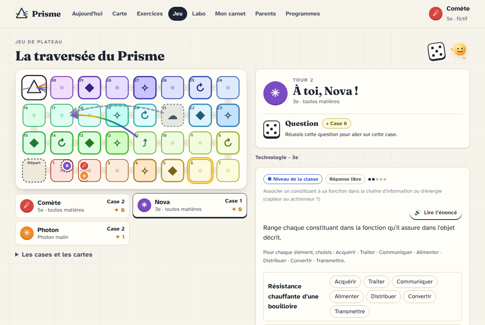
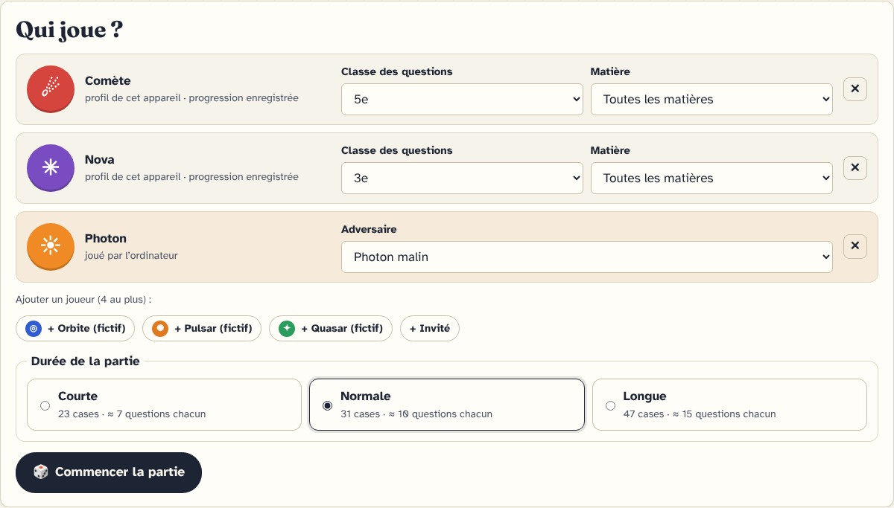

# Jeu de plateau — « La traversée du Prisme »

Objectif : rendre les exercices **aussi ludiques qu'un jeu de société**, sans rien perdre de ce qui fait Prisme :
chaque question reste corrigée, diagnostiquée et comptée dans le modèle de l'élève.

Accès : menu **Jeu**, carte « Jeu de plateau » sur *Aujourd'hui*, bouton « Jouer sur le plateau » de l'*Espace exercices*
(adresse `#/jeu`).

## Règle du jeu (affichée dans l'application)

1. **Lance le dé.** La case visée (ta position + le dé) décide de la question : simple, défi ◆ ou révision ↻.
2. **Réponds.** Réussi : ton pion va sur la case visée. Du premier coup et sans indice : un **éclat de lumière** ✦ en plus.
3. **Raté ?** Le pion avance quand même d'une case, et on lit la correction : se tromper n'est jamais une impasse.
4. **Cases spéciales** (à l'arrivée sur la case) :
   - ⤴ **arc-en-ciel** : raccourci vers une case plus loin ;
   - ☁ **nuage** : question de rattrapage ; ratée, on glisse en arrière (le bouclier en protège) ;
   - ✧ **carte Lumière** : une carte tirée au hasard.
5. **Le Prisme** (dernière case) : on y entre seulement sur une bonne réponse. Le premier arrivé déclenche le
   **dernier tour** : chacun joue autant de tours, puis on classe (ordre d'arrivée, puis position, puis éclats).

| Case | Question posée | Récompense si réussie |
|---|---|---|
| ● case lumière | niveau de la classe | le pion avance |
| ◆ défi | approfondissement (à défaut : exercice de la classe de difficulté ≥ 3) | + 2 éclats |
| ↻ révision | une notion fragile du joueur (maîtrise < 80 % ou révision due) | + 1 éclat |
| ✧ carte, ⤴ arc-en-ciel, ☁ nuage | niveau de la classe | effet de la case |
| △ le Prisme | niveau de la classe (« question finale ») | arrivée |

### Cartes Lumière

Surtout des bonus ; les déplacements dus aux cartes ne déclenchent pas les cases spéciales et ne font jamais entrer dans le Prisme.

| Carte | Effet |
|---|---|
| ➶ Vent solaire | avance de 2 cases |
| ◐ Miroir | rejoue tout de suite |
| ⌕ Loupe | à la prochaine question, le premier indice est gratuit (il ne retire pas d'étoile) |
| ⛉ Bouclier | protège du prochain nuage |
| ✦ Éclat | + 1 éclat |
| ◑ Éclipse | les autres joueurs reculent d'une case |
| ☄ Étoile filante | file jusqu'à la prochaine case Défi |
| ✉ Question cadeau | une question bonus : réussie, + 3 cases |

## Joueurs : tous les niveaux à la même table

De 1 à 4 joueurs sur le même ordinateur :

- **profils de l'appareil** : chaque joueur choisit **la classe et la matière de ses questions** (par défaut, sa classe et
  « toutes les matières »). Un élève de 5e et un de 4e jouent donc ensemble, chacun à son niveau. Ses réponses sont
  enregistrées **dans son propre profil** (contexte `jeu:plateau`) et comptent dans sa carte, son carnet et les recommandations ;
- **invités** (un parent, un ami) : mêmes questions, rien n'est enregistré ;
- **Photon**, joué par l'ordinateur : il lance le dé et « répond » avec une probabilité de réussite selon son niveau
  (tranquille 55 %, malin 70 %, foudroyant 85 % ; moins sur un défi). Il permet de jouer seul.

Les classes proposées sont celles qui ont des exercices (aujourd'hui 5e, 4e et un début de 3e). Pour un profil de primaire
ou de lycée, l'écran le dit (« Pas encore de questions de CM1… ») au lieu de changer de classe en silence.

Deux profils de même couleur reçoivent des pions de couleurs et symboles différents.

## Questions

Une question de jeu doit se jouer en quelques minutes : exercices des leçons **de 4 minutes au plus**, sans rédaction à
faire relire (`open`), ni laboratoire, ni mission ; exercices générés (calcul et données), sans les problèmes à étapes.
La pioche de chaque joueur réutilise la composition des séries de l'Espace exercices (`buildSeries`) : un exercice de
leçon ne revient pas dans la même partie, les exercices récents sont moins probables, et la case Révision est
« adaptée à ses besoins ». En « toutes les matières », la matière de chaque question est tirée au hasard.

Étoiles du jeu (`gameStars`) : 3 = réussi du premier coup sans indice, 2 = au deuxième essai ou avec un indice,
1 = réussi après plus d'essais, 0 = raté ou correction affichée. Une réponse « à relire par un adulte » compte 2.

## Durée et équilibrage

Le plateau est un serpentin de 8 cases par rangée (taille + 1 multiple de 8). Par blocs de 6 cases : une carte, un défi ou une
révision en alternance ; puis 1 à 2 arcs-en-ciel (premiers deux tiers) et 1 à 2 nuages (seconde moitié). Les deux
premières cases et la dernière avant le Prisme restent simples.

Simulation de 300 parties à deux joueurs (`tests/unit/plateau.test.js` vérifie que toute partie se termine) :

| Plateau | Cases | Questions par joueur (70 % de réussite) | à 50 % | à 90 % |
|---|---|---|---|---|
| Courte | 23 | ≈ 7,5 | ≈ 9 | ≈ 6,5 |
| Normale | 31 | ≈ 10 | ≈ 12 | ≈ 8,5 |
| Longue | 47 | ≈ 15 | ≈ 19 | ≈ 13 |

## Sauvegarde et reprise

L'état de la partie est un objet JSON (moteur pur) enregistré dans IndexedDB (`meta`, clé `setting:jeu:partie`) après
chaque action. En revenant sur `#/jeu`, Prisme propose de reprendre la partie ; un dé déjà lancé n'est pas relancé.
Une partie terminée n'est plus proposée.

Pendant la partie, la main passe d'un profil à l'autre sans changer le profil choisi sur l'appareil (l'en-tête ne bouge
pas) : `store.useContext()` / `keepContext()` ; en quittant la page, le profil de l'appareil est rendu.

## Code

| Fichier | Rôle |
|---|---|
| `app/js/engine/plateau.js` | règles pures : plateau, dé, réponses, cartes, tours, fin de partie, Photon, classement |
| `app/js/ui/game/deck.js` | pioche de questions par joueur (classe, matière, genre de case) |
| `app/js/ui/game/board.js` | dessin SVG du plateau, déplacement animé des pions, légende |
| `app/js/ui/game/dice.js` | dé animé |
| `app/js/ui/views/jeu.js` | mise en place, tours de jeu, cartes, classement, reprise |
| `app/css/jeu.css` | style (clair et sombre), animations désactivées si « réduire les animations » |
| `tests/unit/plateau.test.js` | règles et simulation de 400 parties |
| `tests/e2e/jeu.e2e.test.js` | partie à deux profils de classes différentes, reprise, fin, Photon |

Accessibilité : tout se joue au clavier (le focus va au bouton du dé, puis à la zone de réponse), chaque évènement est
annoncé aux lecteurs d'écran, le plateau a une description textuelle des positions, et la liste des joueurs redonne
positions et éclats sans dépendre de la couleur.

## Pistes pour la suite

- Mode coopératif (toute la famille contre Photon, éclats mis en commun).
- Duels : la même question générée pour deux joueurs de même classe.
- Plateaux thématiques par matière (frise historique, carte de géographie).
- Questions de primaire (CP-CM2) dès que les contenus existeront : le jeu les proposera sans changement de code.
